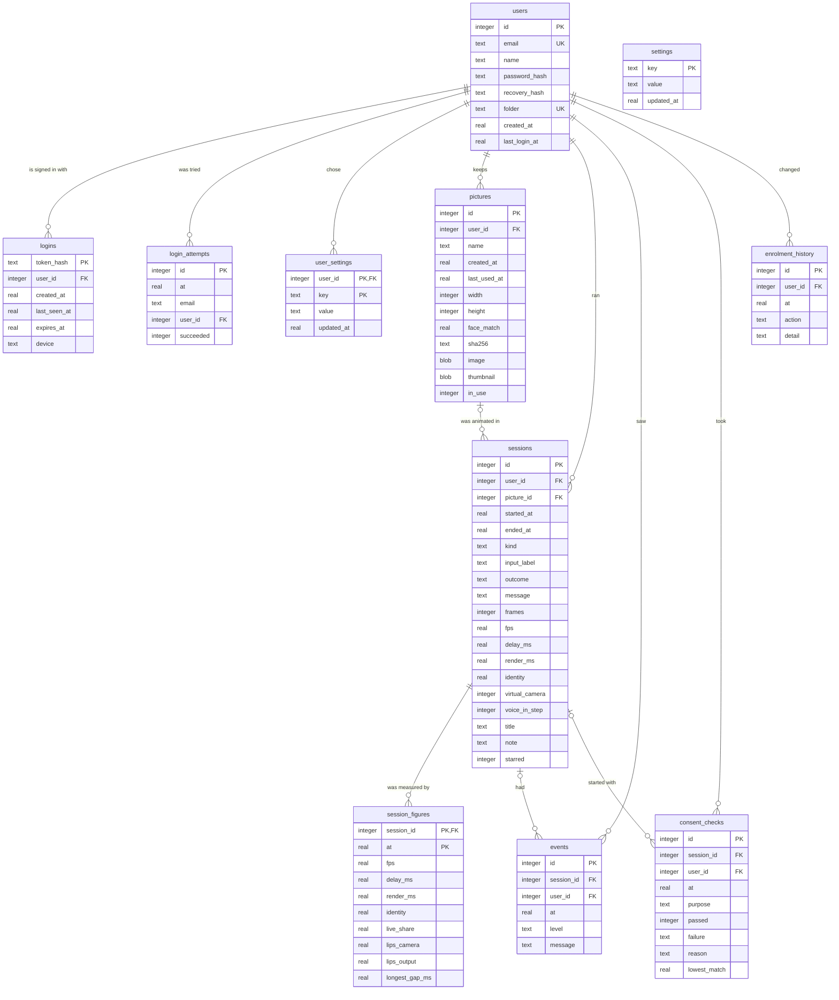

# The database

NeuroPresence keeps everything it remembers in one SQLite file on the user's own computer, `data/neuropresence.db`. Nothing in it is sent anywhere. The code is `neuropresence/database.py` (the schema, the migrations and every query) and `neuropresence/accounts.py` (passwords, sign-ins, recovery codes).

The same structure can be seen inside the app, on the **Your data** screen. That screen draws it from the file itself, so it always shows the schema that is really there, with the number of rows that belong to the person signed in.

## Entity relationship diagram

`settings` stands alone on purpose: it holds what belongs to the computer and not to a person, such as whether the virtual camera is on.

## Data dictionary

Times are seconds since 1970 in UTC, as `REAL`. Yes and no are 1 and 0.

### users: the accounts on this computer

| Column | Type | Rule | Meaning |
|---|---|---|---|
| `id` | INTEGER | primary key, never reused | The account |
| `email` | TEXT | required, unique whatever the letter case | What the person signs in with. No email is ever sent |
| `name` | TEXT | required, 1 to 60 letters | Shown in the app |
| `password_hash` | TEXT | required | scrypt hash of the password, with its own salt and cost |
| `recovery_hash` | TEXT | required | SHA-256 of the recovery code |
| `folder` | TEXT | required, unique | The person's folder in `data/`, with the face signature files |
| `created_at` | REAL | required | When the account was made |
| `last_login_at` | REAL | | The latest sign-in |

### logins: the sign-ins that are still good

| Column | Type | Rule | Meaning |
|---|---|---|---|
| `token_hash` | TEXT | primary key | SHA-256 of the token in the browser's cookie. The token itself is not kept |
| `user_id` | INTEGER | required, `users.id`, cascade | Whose sign-in it is |
| `created_at` | REAL | required | When it began |
| `last_seen_at` | REAL | required | Its last use, written once a minute at most |
| `expires_at` | REAL | required | 30 days with "Keep me signed in", otherwise 12 hours |
| `device` | TEXT | | "Edge on Windows" and the like |

### login_attempts: every try at signing in

| Column | Type | Rule | Meaning |
|---|---|---|---|
| `id` | INTEGER | primary key | |
| `at` | REAL | required | When |
| `email` | TEXT | required | The email that was typed |
| `user_id` | INTEGER | `users.id`, cascade | The account it belongs to, if there is one |
| `succeeded` | INTEGER | required | Did the password match |

### user_settings: a person's switches and choices

| Column | Type | Rule | Meaning |
|---|---|---|---|
| `user_id` | INTEGER | primary key with `key`, `users.id`, cascade | Whose |
| `key` | TEXT | primary key with `user_id` | `feature.even_motion`, `ui.input` and so on |
| `value` | TEXT | required | JSON |
| `updated_at` | REAL | required | When it was last changed |

### pictures: the meeting pictures

| Column | Type | Rule | Meaning |
|---|---|---|---|
| `id` | INTEGER | primary key | |
| `user_id` | INTEGER | required, `users.id`, cascade | Whose |
| `name` | TEXT | required, 1 to 60 letters | The file's name at first; the person can rename it |
| `created_at` | REAL | required | When it was enrolled |
| `last_used_at` | REAL | | When it was last made the meeting picture |
| `width` | INTEGER | required | In pixels |
| `height` | INTEGER | required | In pixels |
| `face_match` | REAL | | How alike its face is to the verified face (1.0 is identical) |
| `sha256` | TEXT | required, unique for a person | So the same picture is not kept twice |
| `image` | BLOB | required | The picture, as PNG |
| `thumbnail` | BLOB | required | A small JPEG of it |
| `in_use` | INTEGER | required, at most one 1 for a person | The one a session animates |

### sessions: one row a session

| Column | Type | Rule | Meaning |
|---|---|---|---|
| `id` | INTEGER | primary key | |
| `user_id` | INTEGER | `users.id`, cascade | Who ran it |
| `picture_id` | INTEGER | `pictures.id`, set null | Which picture it animated |
| `started_at` | REAL | required | |
| `ended_at` | REAL | | Empty while it runs |
| `kind` | TEXT | `camera`, `voice` or `sample` | What drove it |
| `input_label` | TEXT | required | The camera, microphone or clip |
| `outcome` | TEXT | `running`, `stopped`, `refused`, `error` or `interrupted` | How it ended |
| `message` | TEXT | | Why, if not by the person |
| `frames` | INTEGER | required | Frames drawn |
| `fps` | REAL | | Frames a second, the middle of its readings |
| `delay_ms` | REAL | | Camera to output, the middle of its readings |
| `render_ms` | REAL | | Drawing one frame, the middle of its readings |
| `identity` | REAL | | Likeness of the output to the verified face, the middle of its readings |
| `virtual_camera` | INTEGER | required | Was the meeting sent the picture |
| `voice_in_step` | INTEGER | required | Was the voice held back to match the lips |
| `title` | TEXT | 80 letters at most | The name the person gave it |
| `note` | TEXT | 2000 letters at most | The person's note |
| `starred` | INTEGER | required | Kept when the history is cleared |

### session_figures: a reading every two seconds of a session

| Column | Type | Rule | Meaning |
|---|---|---|---|
| `session_id` | INTEGER | primary key with `at`, `sessions.id`, cascade | |
| `at` | REAL | primary key with `session_id` | |
| `fps` | REAL | | Frames a second |
| `delay_ms` | REAL | | Camera to output |
| `render_ms` | REAL | | Drawing one frame |
| `identity` | REAL | | Likeness to the verified face |
| `live_share` | REAL | | How much of the time the live picture was shown, not the still one |
| `lips_camera` | REAL | | How open the lips were at the camera |
| `lips_output` | REAL | | How open they were in the output |
| `longest_gap_ms` | REAL | | The longest time between two frames, which an average hides |

### events: what the event list said

| Column | Type | Rule | Meaning |
|---|---|---|---|
| `id` | INTEGER | primary key | |
| `at` | REAL | required | |
| `level` | TEXT | required | `info`, `warning` or `error` |
| `message` | TEXT | required | |
| `session_id` | INTEGER | `sessions.id`, cascade | The session it happened in, if any |
| `user_id` | INTEGER | `users.id`, cascade | Whose |

### consent_checks: every liveness check

| Column | Type | Rule | Meaning |
|---|---|---|---|
| `id` | INTEGER | primary key | |
| `at` | REAL | required | |
| `purpose` | TEXT | `session` or `verify` | Before a session, or to verify a face |
| `passed` | INTEGER | required | |
| `failure` | TEXT | | What kind of failure |
| `reason` | TEXT | | The same in words |
| `lowest_match` | REAL | | The lowest likeness to the verified face during it |
| `session_id` | INTEGER | `sessions.id`, set null | The session it opened. The check stays when the session is deleted, so deleting one does not clear the retry limit |
| `user_id` | INTEGER | `users.id`, cascade | Whose |

### enrolment_history: every change to the enrolment

| Column | Type | Rule | Meaning |
|---|---|---|---|
| `id` | INTEGER | primary key | |
| `at` | REAL | required | |
| `action` | TEXT | `face_verified`, `pose_registered`, `picture_enrolled`, `picture_removed` or `face_forgotten` | |
| `detail` | TEXT | | Which pose, which picture |
| `user_id` | INTEGER | `users.id`, cascade | Whose |

### settings: what belongs to the computer

| Column | Type | Rule | Meaning |
|---|---|---|---|
| `key` | TEXT | primary key | `virtual_camera.on` and so on |
| `value` | TEXT | required | JSON |
| `updated_at` | REAL | required | |

## How it is kept right

| Concern | What is done |
|---|---|
| Rows without a parent | Foreign keys are on for every connection. Deleting an account deletes its rows in every table; deleting a session deletes its figures and events; deleting a picture leaves the sessions that used it |
| Impossible values | `CHECK` on the kinds and outcomes, `UNIQUE` on emails and on a person's pictures, and a unique index that allows one picture in use for each person |
| One person seeing another's rows | Every query that reads or changes a person's rows is given their id and filters by it. A session or picture of someone else's answers "not found", the same as one that does not exist |
| SQL injection | Every value is passed as a parameter, never put into the SQL text. A search takes `%` and `_` as ordinary characters |
| Half a change | Each piece of work runs in a savepoint inside a transaction: all of it or none |
| The live session waiting on the disk | Writes go through one background thread; reading has its own connection, and the write-ahead log lets both run at once |
| A crash during a session | The write-ahead log leaves the file whole, and a session still open at the next start is closed as `interrupted` at its last reading |
| A new version of the app | Numbered migrations in `PRAGMA user_version`. A step runs in one transaction and is never edited once released |
| Deleted pictures staying in the file | `PRAGMA secure_delete` overwrites what is deleted |
| Growth | An hour of sessions is 1800 readings, 180 KB as measured. Nothing is thrown away by itself: the person clears the history, and starred sessions are kept. 12 pictures a person, and the one unused for longest makes room |

## Passwords and sign-ins

- A password is kept only as a scrypt hash (N = 32768, r = 8, p = 3: 32 MB and about a fifth of a second a try), with its own random salt. Each hash carries its cost, so the cost can be raised later.
- A sign-in is a random token of 256 bits in a cookie that scripts cannot read (`HttpOnly`) and other sites cannot send (`SameSite=Strict`). The database keeps its SHA-256 only, so a copy of the file does not let anyone in.
- A forgotten password is answered by a recovery code of 100 random bits, shown once and good once, since no email is ever sent.
- After five tries in a row that do not match, an email waits a quarter of an hour. The count is in the database, so a restart does not clear it. An email without an account takes the same time and gets the same answer as a wrong password.
- The engine answers only on this computer. Until someone is signed in it refuses everything except signing in, its health, the figures of its speed and the saved benchmarks.
- One account uses the engine at a time, since there is one camera and one graphics card. Signing in to another account signs the one before out, and is refused while a session runs.

## What it does not protect against

Someone with the computer's own Windows or Linux account can open or delete the file: it is not encrypted. The face signatures are files beside it, for the same reason they were before accounts: "Forget my face" removes them outright. Deleting the database also clears the retry limit of the liveness check.

## Why SQLite and not a database server

One person uses it, on their own computer, and the project's promise is that nothing leaves it. SQLite is part of Python, so there is nothing to install or start on the demonstration laptop or on Kubuntu, no service listening on the network, and no password of a server to keep. It is a full SQL database: tables, keys, constraints, indexes and transactions. The schema above uses nothing that is peculiar to it except the partial unique index, which PostgreSQL has too, so moving to a server would change the connection and the types, not the design.
